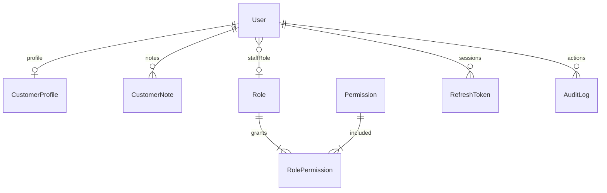
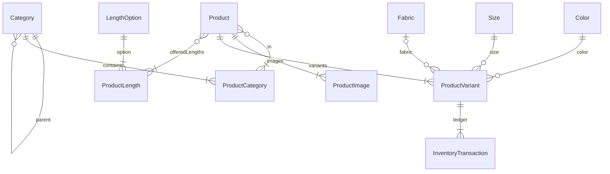
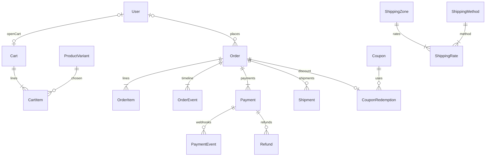
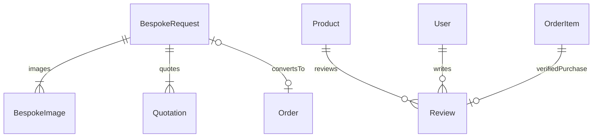

# PERIS platform architecture

Stage 1 proposal for the PERIS luxury abaya store. The customer site, admin, API, and PostgreSQL are one system.

Status: approved. All sixteen defaults were accepted on 6 November 2026. Stage 2 is the current build.

Parent company: Lamasat Jawhareya. Location: Dubai, United Arab Emirates.

Brand colors: burgundy `#751629`, ivory `#f8f7ee`. Primary font: Suisse Intl, loaded from font files when they are added.

CAS Basics informs the shopping mechanics only: best sellers, new arrivals, size plus length, UAE delivery, WhatsApp, and card or cash payment. PERIS keeps its own burgundy and ivory editorial system and its own page structure.

## What this platform is

PERIS is a Dubai boutique platform: ready-to-wear abayas, made-to-length pieces, and bespoke tailoring with a quotation step. The public site sells. The admin at `/admin` operates the business. The API owns prices, stock, VAT, shipping, and payment status.

Three models shape the build:

- **Catalog.** A stocked variant is color, size, and optional fabric. Length is an admin-managed cut, stored on the order line. Measurements are an immutable snapshot, and can also be saved on the customer profile.
- **Money.** Amounts are integers in fils. AED is the store currency. Display prices include 5% VAT, and the rate is a setting. The server recomputes every checkout total.
- **Payment.** Cash on delivery is built in. Ziina Payment Intent is the card gateway. Telr is a reserved adapter. Tabby stays off until a merchant account exists. A success page does not mark an order paid.

## Stack

Exact package versions are locked when the workspace is scaffolded, on current stable releases that work together.

| Layer | Choice | Why this shape |
| --- | --- | --- |
| Web | React 19, Vite, TypeScript, React Router | One SPA. Public and admin shells share one design system. |
| UI state | TanStack Query, Zustand, React Hook Form, Zod | Server state, cart session, and forms stay separate. |
| Style | Tailwind with CSS variables | Burgundy and ivory tokens. Suisse Intl via `@font-face`, Helvetica Neue fallback. |
| API | Node 22, Express, TypeScript | REST under `/api/v1`. Controllers stay thin. Services own business rules. |
| Data | PostgreSQL, Prisma | Normalized schema, migrations, and a seed that can boot a local store. |
| Shared | `packages/shared` | Zod schemas, order statuses, and money helpers used by web and API. |
| Tests | Vitest, Supertest, Playwright | Unit and API tests during the build. Browser journeys in the final stage. |
| Local runtime | Docker Compose Postgres | One command for the database. COD checkout works with no paid accounts. |

### Workspace

```text
peris/
  apps/web/          React storefront and admin shell
  apps/api/          Express API, Prisma schema, migrations, seed
  packages/shared/   Shared Zod schemas, statuses, money helpers
  docs/              Architecture and later setup guides
```

`apps/web` holds layouts, pages, features, components, hooks, services, store, and styles. Customer chrome and admin chrome do not import each other’s pages. A route guard reads the staff role from the admin session.

`apps/api` holds routes, controllers, services, repositories, validators, middlewares, and Prisma. Controllers validate and map HTTP. Services hold stock, pricing, and status transitions. Repositories are the only Prisma callers.

## Runtime

The browser loads one Vite app. Storefront routes and admin routes use different layouts and different login endpoints. Both call the same API. Domain services talk to Prisma. Payments, images, and email sit behind interfaces so a missing credential disables that driver and leaves the rest of the store usable.

```text
Storefront          Admin shell
        \           /
        React + Vite
             |
        Express API
     /     |      \      \
  Auth  Catalog  Commerce  Content
     \     |      /      /
         PostgreSQL
             |
    Commerce also calls payment providers and email
    Catalog also calls image storage
```

WhatsApp click-to-chat is opened by the storefront itself. It is not an API dependency. Automated WhatsApp is a separate notifier, off until configured.

### Request rules

| Concern | Where it lives |
| --- | --- |
| CORS allowlist, Helmet, rate limits | API edge middleware |
| Zod validation | Every write body, query, and param |
| Auth | Short-lived access token in memory. Refresh token in an HttpOnly cookie, rotated on use |
| Password hashing | Argon2id |
| RBAC | Permission keys on the staff role, checked per route |
| Customer isolation | Account queries always filter by the token user id |
| Errors | Stable error codes to the client. Stack traces stay in server logs |
| Audit | Staff mutations write actor, action, entity, and time |
| Logs | pino with a request id. Sentry only when `SENTRY_DSN` is set |
| API docs | OpenAPI served at `/api/docs` |

Public pages set titles, descriptions, Open Graph tags, and product JSON-LD. The API serves `sitemap.xml` and `robots.txt`. The production build can prerender the public catalog. The stack stays React and Vite.

Suisse Intl loads from `/fonts/SuisseIntl-Regular.woff2`. Until those licensed files are added, the fallback is Helvetica Neue, then Arial. Dropping the files in later does not change the layout. Suisse Intl is a commercial font, so the files must be covered by a license the business holds.

## Data model

Fifty-plus tables, grouped by domain. Orders store snapshots of names, prices, addresses, and measurements, so a later product edit does not rewrite history. Products that have been ordered are unpublished or archived, and removed only when no order references them.

### Identity and access



| Entity | Relationships | Rules |
| --- | --- | --- |
| User | One profile if customer. One role if staff | Unique email. `accountType` CUSTOMER or STAFF |
| Role | Many permissions | `super_admin`, `store_manager`, `order_manager`, `product_manager`, `customer_support` |
| Permission | Joined through RolePermission | Checked by route, not by hiding buttons only |
| RefreshToken | Belongs to user | Store the hash. Rotate. Revoke on logout |
| PasswordResetToken | Belongs to user | Single use, short expiry |
| EmailVerificationToken | Belongs to user | Single use |
| CustomerProfile | One-to-one with a customer user | Internal notes stay on CustomerNote |
| AuditLog | Optional actor user | Staff writes, status changes, refunds, setting changes |

### Catalog and inventory



| Entity | Relationships | Rules |
| --- | --- | --- |
| Category | Optional parent. Many products | Slug unique. Sort order. Publish flag. New Arrivals and Best Sellers are queries, and may also be normal categories |
| Product | Many categories, images, variants, lengths, reviews | Slug unique. Type ready-to-wear, made-to-order, or bespoke. Flags for featured, bestseller, and new |
| ProductImage | Belongs to product | Sort order. One primary. URL comes from the storage driver |
| Color, Size, Fabric | Lookup tables | Admin-managed. Seeded with XS through 3XL |
| LengthOption | Lookup. Joined by ProductLength | Label and inches, for example 50 through 60. Active flag |
| ProductVariant | Product plus color, size, optional fabric | SKU unique. Price override optional. `stockOnHand` and `stockReserved` |
| InventoryTransaction | Belongs to variant | Receive, adjust, reserve, release, commit, return. Append-only |

Product flags that operations need:

- `fulfillment`: `STOCKED` or `MADE_TO_ORDER`
- `quoteRequired`: bespoke must be quoted before payment
- `collectsMeasurements`: the product page asks for measurements
- Lead time in days, added to the shipping estimate

### Customers, cart, and wishlist

| Entity | Relationships | Rules |
| --- | --- | --- |
| Address | Belongs to user | UAE emirate plus international country. One default |
| MeasurementProfile | Belongs to user | Height, shoulder, sleeve, chest, waist, desired length, notes |
| Cart | Optional user. Many items | Guest token for visitors. One open cart per user |
| CartItem | Variant, optional length, optional measurement JSON | Quantity. Unique on cart, variant, and length |
| Wishlist | One per user | Items reference products |
| WishlistItem | Wishlist and product | Created time for sorting |

### Orders, payments, and shipping



| Entity | Relationships | Rules |
| --- | --- | --- |
| Order | Optional user. Many items, payments, events, shipments | Number from a sequence, `PR-10001`. Idempotency key unique. Address copied onto the order |
| OrderItem | Order. Optional product and variant ids | Name, SKU, color, size, fabric, length, unit price, and measurements copied at purchase |
| OrderEvent | Order. Optional actor | Timeline for every status change |
| Coupon | Optional product and category limits | Percent, fixed fils, or free shipping. Window, usage limit, first-order flag |
| CouponRedemption | Coupon, order, optional user | Counted inside the same transaction as the order |
| Payment | Order | Provider, provider reference unique, amount, status, method |
| PaymentEvent | Optional payment | Provider event id unique. Raw payload retained for audit |
| Refund | Payment. Optional actor | Amount and provider reference |
| ShippingZone | Many rates | Country, and emirate when the country is AE |
| ShippingMethod | Many rates and shipments | Lead-time range. COD allowed flag |
| ShippingRate | Method and zone | Price in fils. Optional free-over threshold |
| Shipment | Order | Carrier, tracking number, tracking URL, status |

### Bespoke, content, and engagement



| Entity | Relationships | Rules |
| --- | --- | --- |
| BespokeRequest | Optional user, product, fabric, color. Many images and quotes | Statuses from submitted through converted. Optional resulting order |
| BespokeImage | Request | Stored through the same image pipeline as products |
| Quotation | Request. Created by a staff user | Amount, message, validity, sent or accepted |
| Review | Product, user, one order item | Pending until a staff user approves it. Optional public reply |
| CmsPage | Standalone | Slug, title, body, draft or published. Policy pages start as pending approval |
| Banner | Standalone | Hero, collection, or promo placement. Schedule and sort |
| Announcement | Standalone | One active bar. Optional link and schedule |
| StoreSetting | Key and JSON value | VAT, WhatsApp number, social links, maintenance, currency |
| NewsletterSubscriber | Standalone | Unique email. Unsubscribe token |
| Appointment | Standalone | Fitting or consultation. Requested, confirmed, cancelled |
| ContactMessage | Standalone | Inbox for the contact form |
| Notification | Optional user | Email or WhatsApp attempt, template, status, error |
| Campaign | Optional linked products | Homepage promotion window. Coupons remain the discount engine |

### Integrity the database enforces

| Constraint | Purpose |
| --- | --- |
| Unique user email, product slug, variant SKU, coupon code, order number | Stable public identity |
| Unique payment provider reference and webhook event id | Duplicate charges and duplicate webhooks stop at the database |
| Unique checkout idempotency key | A double-clicked pay button creates one order |
| Check constraints on money and stock | No negative totals. Reserved stock cannot exceed on-hand |
| Indexes on order status plus date, product publish plus date, and order email plus number | Dashboard filters and order tracking stay fast |
| Foreign keys with restrict on financial history | Payments and order lines survive catalog cleanup |

## Storefront routes

SEO slugs come from the database. Category and product URLs stay stable when a title is edited, unless an editor changes the slug on purpose.

| Route | Page |
| --- | --- |
| `/` | Editorial home: announcement, hero, collections, best sellers, new arrivals, story, services, Instagram, reviews, newsletter |
| `/shop` | All products, filters, sort, pagination |
| `/shop/:categorySlug` | Category catalog |
| `/collections` | Collection index |
| `/collections/:slug` | Collection landing |
| `/new-arrivals` | Latest published products |
| `/product/:slug` | Gallery, zoom, variants, length, stock, measurements when required, reviews, related, recently viewed |
| `/bespoke` | Seven-step tailoring request |
| `/about` | Brand story using the supplied Lamasat Jawhareya copy |
| `/contact` | Form, call, WhatsApp, map, appointment request |
| `/search` | Search results |
| `/cart` | Cart |
| `/checkout` | Guest or signed-in checkout |
| `/checkout/confirmation` | Pending confirmation while the server verifies payment |
| `/track-order` | Order number and email lookup |
| `/wishlist` | Wishlist |
| `/size-guide` | Size guide |
| `/faq` | FAQ from the CMS |
| `/policies/:slug` | Shipping, returns, privacy, terms, payment. Drafts show an approval notice |
| `/account/login` | Login |
| `/account/register` | Registration |
| `/account/forgot-password` | Forgot password |
| `/account/reset-password` | Reset password |
| `/account/verify-email` | Email verification |
| `/account` | Profile and password |
| `/account/orders` | Order history |
| `/account/orders/:orderNumber` | Order detail and timeline |
| `/account/addresses` | Addresses |
| `/account/measurements` | Saved measurements |
| `/account/bespoke` | Own tailoring requests and quotes |
| `/maintenance` | Shown when the store setting is on. Admin stays available |
| `*` | 404 |

Header, footer, bag count, wishlist, search, and the floating WhatsApp control (“Order Now”) sit on every customer page. From a product, the WhatsApp draft includes the product name and URL. From bespoke, it is a tailoring inquiry. From an order, it includes the order number. The number is `+971505406077` (`https://wa.me/971505406077`).

### Supplied brand content

**Home hero.** “Elegance, Meticulously Tailored.” Sub-headline is the supplied welcome copy about Khaleeji heritage and contemporary sophistication. Calls to action: Explore Our Collections, and Chat with Us on WhatsApp.

**Collections.** Casual Elegance, Evening & Occasions, Bespoke Designs, with the supplied descriptions.

**Services.** Bespoke Tailoring, Premium Fabrics, Master Craftsmanship, with the supplied copy.

**About.** The supplied paragraph beginning “Born in the heart of Dubai under the umbrella of ‘Lamasat Jawhareya’…”

**Contact.** Boutique M01, 3 Floor, Abu Hail Center, Dubai. Daily 10:00 AM to 10:00 PM. Phone and WhatsApp `+971505406077`. Instagram `https://www.instagram.com/peris_uae/`. Facebook `https://www.facebook.com/perisdubai`. Map `https://share.google/yXXt6E0JO91xU9lmA`.

## Admin routes

Each route is wrapped in the staff session guard and a permission check.

| Route | Module |
| --- | --- |
| `/admin/login` | Staff login |
| `/admin` | Overview and date filters |
| `/admin/products` | Product list |
| `/admin/products/new` | Create product |
| `/admin/products/:id` | Edit, images, variants, duplicate |
| `/admin/inventory` | Stock, alerts, adjustment history |
| `/admin/orders` | Search, filter, export |
| `/admin/orders/:id` | Detail, status, tracking, invoice, refund |
| `/admin/customers` | Customer search |
| `/admin/customers/:id` | Profile, orders, measurements, notes |
| `/admin/categories` | Category tree |
| `/admin/coupons` | Discounts |
| `/admin/reviews` | Moderation |
| `/admin/bespoke` | Tailoring queue |
| `/admin/bespoke/:id` | Quote and convert to order |
| `/admin/content` | Hero, banners, pages, FAQ, announcement |
| `/admin/marketing` | Newsletter, campaigns, featured placements |
| `/admin/shipping` | Zones, rates, thresholds, carriers |
| `/admin/appointments` | Fitting requests |
| `/admin/staff` | Roles and staff accounts |
| `/admin/reports` | Sales, orders, customers, products, inventory |
| `/admin/settings` | Store, VAT, payments, email, maintenance |
| `/admin/audit` | Audit log |

The admin uses the same burgundy and ivory system, with denser tables and a persistent side navigation. It is usable on a tablet. Staff never share the customer login cookie.

### Modules

| Module | Staff can |
| --- | --- |
| Overview | Filter today, 7 days, 30 days, this month, last month, or a custom range. Revenue, orders, customers, products, low stock, best sellers, recent orders |
| Products | Create, edit, archive, duplicate, price, sale price, SKU, categories, images, variants, featured and bestseller flags, publish |
| Inventory | On-hand and reserved per variant, low-stock and out-of-stock, adjustment history, export |
| Orders | Search and filter, timeline, status, payment status where permitted, tracking, invoice, cancel, refund, export |
| Customers | Search, profile, orders, measurements, internal notes, enable or disable |
| Categories | Create, edit, reorder, nest, publish |
| Coupons | Percent, fixed, free shipping, minimum, expiry, usage limits, product or category scope, first order |
| Reviews | Approve, reject, delete, reply |
| Bespoke | Review measurements and images, contact, quote, approve, reject, convert to an order |
| Content | Hero, banners, about, services, FAQ, policies, footer, Instagram, announcement |
| Marketing | Subscribers, campaigns, homepage promotions, featured products |
| Shipping | UAE zones, international zones, fees, free thresholds, estimates, carriers, tracking |
| Staff | Five roles. A person only receives the permissions of their role |
| Settings and reports | Store identity, VAT, payments, email, maintenance. CSV and Excel exports |

### Permission matrix

Super Admin holds every permission, including staff management and payment settings. The seed creates one Super Admin from `ADMIN_EMAIL` and `ADMIN_PASSWORD`. The password is hashed with Argon2id and must be changed after first login.

| Permission | Store manager | Order manager | Product manager | Support |
| --- | --- | --- | --- | --- |
| Dashboard | Yes | Yes | Yes | Yes |
| Products and categories | Yes | — | Yes | — |
| Inventory | Yes | — | Yes | — |
| Orders and shipments | Yes | Yes | — | View |
| Refunds | Yes | Yes | — | — |
| Customers and notes | Yes | View | — | Yes |
| Bespoke quotes | Yes | Yes | — | View |
| Reviews | Yes | — | Yes | Yes |
| Content and policies | Yes | — | — | — |
| Coupons and marketing | Yes | — | — | — |
| Shipping settings | Yes | — | — | — |
| Reports export | Yes | Yes | Yes | — |
| Store and payment settings | Yes | — | — | — |
| Staff accounts | — | — | — | — |
| Audit log | Yes | — | — | — |

## REST API

Base path `/api/v1`. Public reads are cacheable. Writes require the matching session. Admin routes require a staff access token and a permission.

### Auth and account

| Endpoint | Access | Behavior |
| --- | --- | --- |
| `POST /auth/register` | Public | Create customer, send verification |
| `POST /auth/login` | Public | Customer session |
| `POST /auth/logout` | Customer | Revoke refresh token |
| `POST /auth/refresh` | Cookie | Rotate refresh token |
| `POST /auth/forgot-password` | Public | Always returns a generic success |
| `POST /auth/reset-password` | Public | Single-use token |
| `POST /auth/verify-email` | Public | Mark email verified |
| `GET /account` | Customer | Own profile |
| `PATCH /account` | Customer | Update profile |
| `POST /account/password` | Customer | Change password |
| `GET POST /account/addresses` | Customer | List and create |
| `PATCH DELETE /account/addresses/:id` | Customer | Own address only |
| `GET POST /account/measurements` | Customer | Saved measurements |
| `PATCH DELETE /account/measurements/:id` | Customer | Own measurements only |
| `GET /account/orders` | Customer | Own orders |
| `GET /account/orders/:orderNumber` | Customer | Own order detail |

### Catalog, content, and search

| Endpoint | Access | Behavior |
| --- | --- | --- |
| `GET /categories` | Public | Published tree |
| `GET /products` | Public | Filter, sort, paginate |
| `GET /products/:slug` | Public | Detail, variants, lengths, stock |
| `GET /products/:slug/related` | Public | Same categories |
| `GET /search` | Public | Name, SKU, description, fabric |
| `GET /content/home` | Public | Hero, collections, announcement, services |
| `GET /content/pages/:slug` | Public | CMS page |
| `GET /content/public-settings` | Public | Phone, social, VAT display, maintenance |
| `GET /reviews` | Public | Approved reviews for a product |
| `POST /reviews` | Customer | Verified purchase only |
| `POST /newsletter` | Public | Subscribe |
| `POST /contact` | Public | Contact message |
| `POST /appointments` | Public | Fitting or consultation request |
| `GET /sitemap.xml` and `GET /robots.txt` | Public | Generated from published URLs |

### Cart, checkout, and payments

| Endpoint | Access | Behavior |
| --- | --- | --- |
| `GET /cart` | Guest or customer | Current cart and server totals |
| `POST /cart/items` | Guest or customer | Add variant, length, quantity |
| `PATCH DELETE /cart/items/:id` | Owner | Quantity, variant, or removal |
| `POST DELETE /cart/coupon` | Owner | Apply or remove. Server checks rules |
| `POST /cart/merge` | Customer | Merge guest cart after login |
| `POST /checkout/quote` | Guest or customer | Shipping options and final totals |
| `POST /checkout` | Guest or customer | Create order from a fresh server quote |
| `GET /checkout/payment-methods` | Public | Methods enabled for the address |
| `POST /payments/ziina/webhook` | Ziina HMAC signature | Verify and update payment |
| `POST /payments/telr/webhook` | Telr signature | Reserved adapter |
| `GET /payments/:id/status` | Owner | Server-side provider lookup |
| `GET /orders/track` | Public | Order number plus email |
| `GET /wishlist` and item writes | Customer | Own wishlist |

### Bespoke

| Endpoint | Access | Behavior |
| --- | --- | --- |
| `GET /bespoke/options` | Public | Designs, fabrics, colors, lengths |
| `POST /bespoke/requests` | Guest or customer | Measurements, notes, images |
| `GET /account/bespoke` | Customer | Own requests |
| `POST /account/bespoke/:id/accept` | Customer | Accept a live quote and open an order |
| `GET PATCH /admin/bespoke` | `bespoke.write` | Queue and status |
| `POST /admin/bespoke/:id/quote` and `/convert` | `bespoke.write` | Send a quote or create an order |

### Admin

| Endpoint | Permission | Behavior |
| --- | --- | --- |
| `POST /admin/auth/login`, logout, refresh | Staff | Rejects customer accounts |
| `GET /admin/dashboard` | `dashboard.read` | Revenue, orders, stock, charts, date range |
| CRUD `/admin/products` | `products.write` | Images, reorder, duplicate, publish, variants |
| CRUD `/admin/categories`, colors, sizes, fabrics, lengths | `products.write` | Lookup data |
| `GET POST /admin/inventory` | `inventory.write` | Levels, adjust, history |
| `GET PATCH /admin/orders` | `orders.write` | Search, status, shipment |
| `POST /admin/orders/:id/refund` | `orders.refund` | Provider refund where the gateway supports it |
| `GET /admin/orders/:id/invoice` | `orders.write` | Printable invoice |
| `GET /admin/orders/export` | `reports.read` | CSV and Excel |
| `GET PATCH /admin/customers` | `customers.write` | Profile, notes, status |
| CRUD `/admin/coupons` | `marketing.write` | Rules and limits |
| `PATCH /admin/reviews` | `reviews.moderate` | Approve, reject, reply, delete |
| CRUD `/admin/content` | `content.write` | Pages, banners, FAQ, announcement |
| CRUD `/admin/shipping` | `shipping.write` | Zones, methods, rates |
| CRUD `/admin/staff` | `staff.write` | Super Admin only in the seed matrix |
| `GET PATCH /admin/settings` | `settings.write` | Store, VAT, providers, maintenance |
| `GET /admin/reports/:type` | `reports.read` | Sales, customers, products, inventory |
| `GET /admin/audit` | `audit.read` | Filterable staff history |

## Commerce rules

| Step | Who calculates | Result |
| --- | --- | --- |
| Cart edits | API | Line prices from the current variant, plus selected length |
| Address | API | Shipping rates for that zone. COD hidden outside the UAE, and wherever the method disallows it |
| Coupon | API | Reject expired, exhausted, wrong product, or below the minimum |
| Quote | API | Subtotal, discount, shipping, VAT, total. This quote has a short lifetime |
| Place order | API | Re-check quote, stock, and coupon inside one database transaction. Reserve stock. Status is awaiting payment, or confirmed for COD |
| Pay | Provider | Redirect to Ziina hosted checkout, or a later Telr page. Card numbers never reach PERIS |
| Confirm | API | Webhook signature or a server retrieval updates the same payment row |
| Commit | API | On paid, or on COD confirmation, convert the reservation into a stock deduction and queue the email |

### Order status

| Status | Meaning |
| --- | --- |
| Pending | Created, not yet confirmed |
| Awaiting payment | Waiting for the provider |
| Paid | Provider amount matched the order |
| Confirmed | Accepted. COD can reach here before cash is collected |
| Processing | Being prepared |
| Tailoring | In the workroom |
| Ready for shipment | Packed |
| Shipped | Handed to the carrier. Tracking stored |
| Out for delivery | With the courier |
| Delivered | Completed |
| Cancelled | Stopped. Reservation released |
| Refunded | Money returned through the provider, or recorded for COD |

### Payment status

Payment status is separate from fulfillment status. A tailored order can be paid and still be in the workroom. A COD order can be confirmed while payment is still unpaid, then marked paid when the courier collects.

| Payment status | Set by |
| --- | --- |
| Unpaid | COD or abandoned checkout |
| Pending | Customer sent to the provider |
| Paid | Verified webhook or server lookup |
| Failed | Provider failure. Stock released |
| Refunded | Full refund recorded |
| Partially refunded | Partial amount recorded |

A reservation lasts 30 minutes by default, from a store setting. A scheduled pass releases expired reservations and cancels unpaid orders. The same pass retries failed notification rows.

### Payment provider interface

```ts
interface PaymentProvider {
  key: "ziina" | "telr" | "tabby" | "cod";
  createPayment(order): Promise<{ redirectUrl?: string; status: PaymentStatus }>;
  handleWebhook(rawBody, headers): Promise<VerifiedEvent>;
  refund(payment, amount): Promise<RefundResult>;
}
```

COD creates an unpaid payment and needs no webhook. Ziina uses Payment Intents and a hosted redirect. The success URL only polls `GET /payments/:id/status`. Email and media use the same pattern: `ConsoleMailer` or SMTP, `LocalDiskStorage` or Cloudinary, selected by environment.

## External services

Each integration has a driver interface. The local driver is the default. Setup docs and the admin settings screen will say when a provider is not connected.

| Service | Local behavior | Production credential | Used for |
| --- | --- | --- | --- |
| PostgreSQL | Docker Compose | `DATABASE_URL` | All business data |
| Ziina Payment Intent | Hidden until API token exists | `ZIINA_API_TOKEN`, `ZIINA_WEBHOOK_SECRET`, `ZIINA_TEST` | Cards, Apple Pay, Google Pay via Ziina hosted checkout |
| Telr | Adapter present, disabled | `TELR_STORE_ID`, `TELR_AUTH_KEY` | UAE gateway if the bank prefers it |
| Tabby | Disabled | `TABBY_PUBLIC_KEY`, `TABBY_SECRET_KEY` | Buy now, pay later after merchant approval |
| Cash on delivery | Available | None | UAE orders, zones chosen in admin |
| Cloudinary | Local `/uploads` | `CLOUDINARY_CLOUD_NAME`, API key, API secret | Product, banner, and bespoke images |
| Email | Console logger | SMTP host, port, user, password, `MAIL_FROM` | Verification, reset, order, quote, appointment |
| WhatsApp links | Live | Public number `+971505406077` | Order Now, product, bespoke, and order messages |
| WhatsApp Cloud API | Off | `WHATSAPP_CLOUD_TOKEN`, phone number id | Optional automated status messages |
| Sentry | Off | `SENTRY_DSN` | Error monitoring |
| Google Maps | Link plus embed | Public map URL already supplied | Boutique location on Contact |

`.env.example` will ship with empty secrets and safe local defaults. The web app receives only public values: API URL and the WhatsApp number. Webhook routes read the raw body and reject a bad signature. Uploads accept JPEG, PNG, and WebP after a type check, with a size limit.

### Honest state until a service is connected

| Area | What the product shows |
| --- | --- |
| Card payment | Unavailable, with COD still offered where the zone allows |
| Tabby | Not offered |
| Email | Logged on the server in development. Failed sends stay in Notification for retry |
| WhatsApp automation | Click-to-chat works. Automatic WhatsApp delivery is not claimed |
| Policies | Banner: pending approval from the business owner |
| Photography | Placeholder frames labeled as temporary, replaced by uploads |

### Still needed from the business before a live launch

The schema stores all of these. The seed will use blank or obviously draft values until they are supplied.

- VAT registration number (TRN)
- Legal name on the invoice
- Free-shipping threshold
- COD fee and maximum order value
- Ready-to-wear lead time
- Bespoke lead time

## Defaults

These are the decisions the build will follow unless a number is changed.

| # | Default | If left unchanged |
| --- | --- | --- |
| 1 | pnpm workspace: `apps/web`, `apps/api`, `packages/shared` | One repo, shared validation |
| 2 | One SPA. Admin lives at `/admin` with its own login | Separate shells, one deployment of the web build |
| 3 | Money stored as fils. Currency AED | No floating-point prices |
| 4 | Prices include 5% VAT. Rate is a store setting | Invoices need the trade name and TRN before going live |
| 5 | Variant = color × size × optional fabric. Length is a cut option | Admin edits lengths without a code change |
| 6 | Bespoke is request, quote, accept, then order | Fixed-price pieces can still go straight to the cart |
| 7 | COD plus Ziina Payment Intent sandbox. Telr reserved. Tabby disabled | Live cards wait for real keys |
| 8 | Paid status comes from a verified webhook or a server lookup | The return URL only shows a pending confirmation |
| 9 | Reserve stock at checkout. Commit on payment or COD confirm | Abandoned checkouts release stock on a timer |
| 10 | English for version 1. Copy is keyed for a later Arabic pass | RTL is a later stage |
| 11 | Local image disk and console email until credentials exist | The app runs before Cloudinary or SMTP is ready |
| 12 | WhatsApp opens `wa.me/971505406077` with a prepared message | The Business API stays off until Meta credentials exist |
| 13 | Policies ship as drafts labeled pending owner approval | Draft return and shipping text is not treated as final |
| 14 | Development products are flagged placeholders | They can be hidden when real PERIS photography arrives |
| 15 | Suisse Intl is loaded from `/fonts` when the licensed files are added | The layout does not change when the files are dropped in |
| 16 | Guest checkout, then cart merge on login | A customer can buy without an account |

## Roadmap

Estimates are working days for one senior engineer after this architecture is approved. Each stage leaves a runnable slice. Later stages replace development placeholders with live admin data. Stages 2 and 4 can overlap once the schema is agreed. Stages 2 through 8 are 53 working days, about 8 to 11 calendar weeks with review time.

| Stage | Days | Done when |
| --- | --- | --- |
| 1. Architecture | — | This proposal is approved |
| 2. Design system and home | 5 | Burgundy and ivory, type, header, footer, homepage, mobile nav, with placeholder imagery labeled |
| 3. Shopping screens | 8 | Shop, product, variants, length, cart, checkout, account, bespoke, and content pages render and validate |
| 4. API and database | 10 | Prisma schema, migrations, seed, auth, catalog, cart, and RBAC tests pass |
| 5. Admin | 12 | Every module writes to the database and the public site reads those writes |
| 6. Payments and delivery | 6 | COD, Ziina test mode, webhooks, shipping settings, tracking, and email templates |
| 7. Integration | 6 | Storefront uses the API only. Guest checkout, login merge, and bespoke conversion work |
| 8. Test and release | 6 | Journey tests, security pass, README, deployment, backup notes, admin bootstrap |

### Journeys covered by tests

| Journey | Stage that locks it |
| --- | --- |
| Register, verify, login, reset password | 4 |
| Browse, filter, choose size and length, add to cart | 7 |
| Checkout, sandbox payment, order in admin | 7 |
| Failed payment, bad coupon, insufficient stock | 6 and 7 |
| Duplicate webhook does not create a second order | 6 |
| Admin status change, customer notification, tracking page | 7 |
| Bespoke request, quote, convert | 7 |
| Support role cannot open settings or refunds | 4 and 5 |

## After approval

Stage 2 starts with the workspace scaffold, design tokens, Suisse Intl font hook, header, footer, and the editorial homepage. The API schema follows immediately after the visual foundation is in place, so the shop is never left on permanent mock data.
